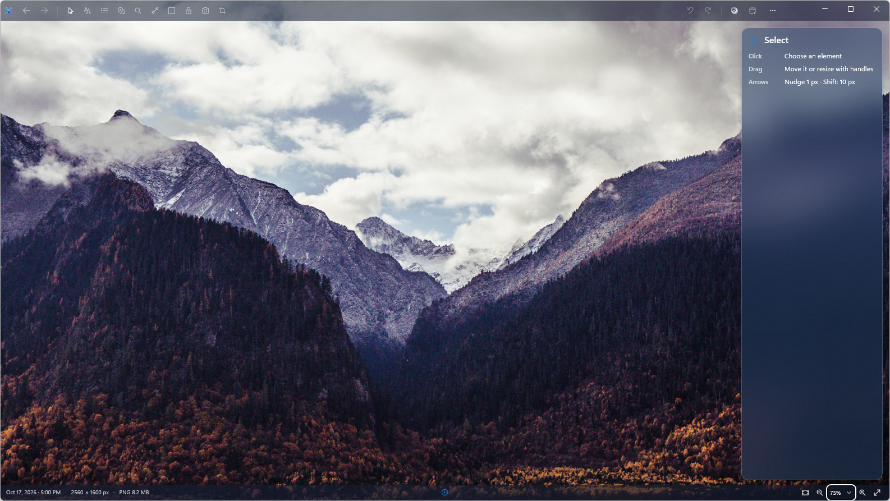
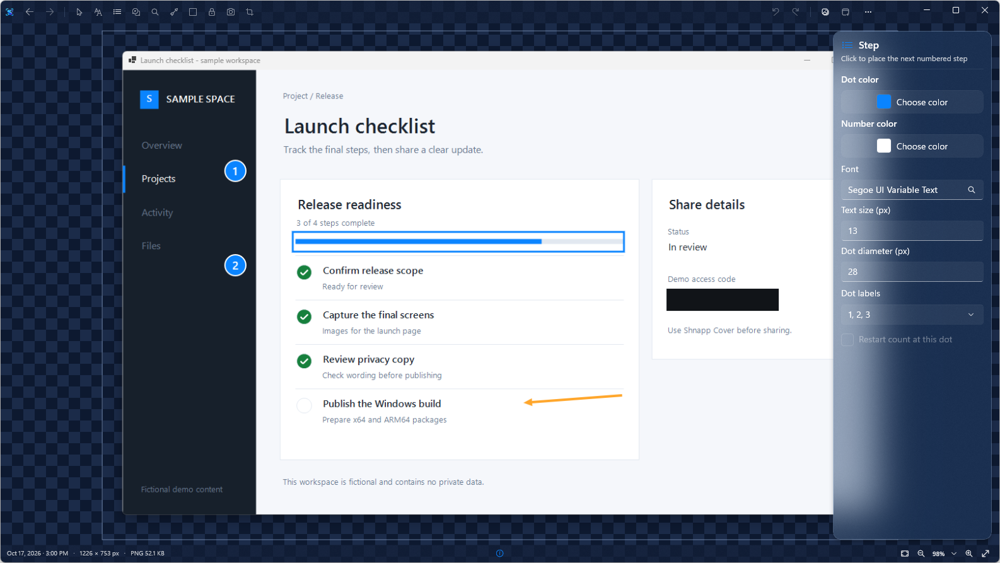
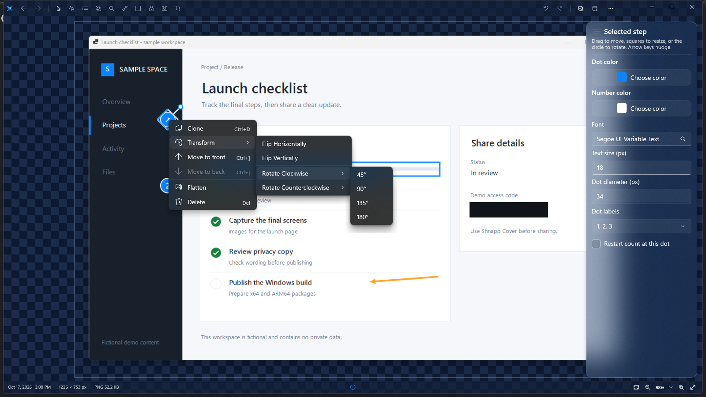
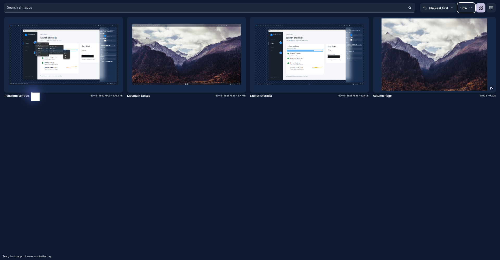

<p align="center">
  
</p>

<h1 align="center">Capture first. Think less.</h1>

<p align="center">
  Press a shortcut. Show what matters. Share a clearer picture.
</p>

<p align="center">
  <strong>Made for Windows 11 · Native WinUI · Local by default</strong>
</p>

Shnapp waits quietly in your tray until you need it. Capture part of your screen, add a little context, then copy the finished image or save a PNG. Every capture is a **shnapp**; making one is **shnapping**.

## See Shnapp in action

[Watch the 39-second Shnapp v2 tour](src/Shnapp.Site/public/demos/shnapp-workflow.mp4) for the full-window canvas, floating options, transforms, sharing actions, and local library. The app captures below use a fictional sample workspace.

| Full-window canvas and acrylic options | Annotated editor |
| --- | --- |
| [](src/Shnapp.Site/public/screenshots/photo-canvas.png) | [](src/Shnapp.Site/public/screenshots/editor.png) |
| **Rotate and flip** | **Local library** |
| [](src/Shnapp.Site/public/screenshots/rotate-transform.png) | [](src/Shnapp.Site/public/screenshots/library.png) |

See the [unobstructed photo canvas](src/Shnapp.Site/public/screenshots/photo-canvas-clean.png), [rotation handle](src/Shnapp.Site/public/screenshots/editor-rotation.png), [magnifier, pixelate, and callout](src/Shnapp.Site/public/screenshots/editor-magnify.png), [empty library](src/Shnapp.Site/public/screenshots/empty-library.png), and [settings](src/Shnapp.Site/public/screenshots/settings-general.png).

The landscape is [“Mountain lake in the autumn” by sayid he](https://commons.wikimedia.org/wiki/File:Mountain_lake_in_the_autumn_(Unsplash).jpg), available under [CC0 1.0](https://creativecommons.org/publicdomain/zero/1.0/). Video music is [“Cloud Dancer” by Kevin MacLeod](https://incompetech.com/music/royalty-free/index.html?isrc=USUAN2300007), licensed [CC BY 4.0](https://creativecommons.org/licenses/by/4.0/); the tour uses an edited excerpt with fades.

## Make a shnapp

Start a capture with a [keyboard shortcut](#keyboard-shortcuts), the tray icon, or **Capture** in the app. Enable Print Screen in **Settings → Shortcuts** to intercept the plain key while Shnapp is running; Alt+Print Screen keeps its Windows behavior. Region capture currently uses a rectangle; a drawn free-form selection is planned.

Choose a camera in Settings or leave it on Automatic. A camera photo opens as an editable shnapp, and the camera button in the editor adds another photo as a movable layer. Select a photo layer to crop it or reset its crop. Camera actions are disabled when no camera is connected.

The grabber freezes the visible desktop when capture starts, so moving content holds still while you choose. A crosshair and live pixel measurements help you draw a region; hold Shift for a square. A bright pulse frames the window or display you are about to capture. Window shnapps use the visible pixels from that frozen moment, including anything overlapping the window.

## Record and edit video

Start a video from a [keyboard shortcut](#keyboard-shortcuts), the capture menu, or the tray. Choose a window, a display, or a rectangular region with the same picker used for screenshots. A small recording bar shows elapsed time and the active audio sources; pause, resume, stop, or cancel there. Window recordings follow the selected window as it changes. **Settings → Recording** controls computer audio, microphone input, pointer visibility, and optional camera video. Both audio sources are off by default. A camera recording is placed as an independently editable layer above the screen video. If the camera is unavailable, the screen recording is still saved and the editor explains what happened.

Saved videos appear beside screenshots in the local library and reopen in a dedicated editor. The compact title bar holds media, text, audio, trim, cut, split, transition, timeline snapping and zoom, and export tools. Trim, split, or cut the video and adjust the computer and microphone tracks independently. The left-edge media rail pages through saved images and videos: click a capture to open it, use its **+** button to add it at the playhead, or drag it onto the timeline. Dropping a video creates its own timed layer above the original recording without shifting existing clips. Shnapp copies its original recording and available computer/microphone audio stems; edits made in that video's own project are not copied. Paste an image or import your own audio. Imported media can extend the timeline beyond the original recording. Edits keep the source files intact. Export an MP4 when ready to share.

Add a text overlay at the playhead with the title-bar **Text** tool. Type directly on the video, then drag its top grip to move it or its corner grip to resize it. The small canvas toolbar changes font, bold/italic, size, background, and placement at nine safe-margin positions. The right panel offers precise timing, text color and alignment, background color, padding, border, and corners. Changes appear as you work; there is no Apply step for text. Text clips can also be dragged and trimmed on the timeline.

The compact timeline has a time ruler, grid guides, media thumbnails, separate visual and audio rows, and a marker where clips touch on the same track. Scroll over the tracks to zoom around the pointer; the title bar also has zoom and snapping buttons. Drag a row's grip beside its eye or speaker to change layer order within the visual or audio section. The original video stays at the base. Lock a row beside its visibility control to prevent edits and reordering until you unlock it. Use each visual row's eye to show or hide it, or an audio row's speaker to mute it; the clips and their timing stay in place. Click the **+** marker to add one transition across a cut, then select its marker to change the effect or duration. Fade, dip to black or white, four slide directions, and zoom in or out work with video, image, and text clips. To transition between separately imported video, image, or text layers that touch in time, right-click the incoming clip and choose **Transition from…**; Shnapp places them on one track. A selected base video clip's separate **Fade in** and **Fade out** fields remain available for its outside edges.

In the video editor, click a clip to select it, drag its middle to move it, or drag its left or right edge to trim it. Click a visible image, text, or imported video on the preview to select it there. Drag the selected image or imported video to move it, use its corner and side handles to resize it, or turn on Crop to trim its source without replacing the file. Reset crop restores the full source. Select a webcam or other video overlay to remove it with **Delete** or the trash icon. Its crop-shape menu and Properties panel offer the original rectangle, 1:1 square, circle, squircle, oval, and rounded rectangle; choosing the original rectangle restores its previous frame. Canvas selection keeps the image clear for direct manipulation; use the small Properties icon above the selection for exact fields, or click its timeline clip. Closing Properties keeps the clip selected. Hold Shift while moving or resizing selected visual media to keep movement on one axis or preserve proportions. The output canvas always keeps the original recording's width and height: media moved beyond that rectangle is clipped in the preview and final MP4. A clip can still extend the timeline beyond the recording; the remaining base picture is black. Click empty timeline space to seek. Text fields and sliders keep their normal keyboard behavior; the full editor key map is in [Keyboard shortcuts](#keyboard-shortcuts).

## Explain it in a few clicks

The editor gives your capture the full window, including the area behind its translucent title bar and compact footer. The title bar keeps navigation, tools, camera, library, and actions together. File details sit at the left of the footer, the info-panel toggle stays centered, and fit, zoom, and full-screen controls sit at the right. The acrylic options panel floats over the image and changes with the selected tool without resizing the canvas. Place a mark and it stays selected: changes in the panel update that mark right away. Select an earlier mark to adjust it, or drag its handles to resize it. When nothing is selected, your choices set up the next mark.

Paste copied words to turn them into an editable text mark or a copied picture into a movable image. If either reaches past the capture, Shnapp grows the transparent canvas around it. Remove or move that mark and the unused space falls away.

To work with several marks at once, add each element to the selection or select every visible editable element. An outline shows the selected group. Drag any selected element to move the group; hold Shift while dragging to keep the move horizontal or vertical. You can also nudge the group with the arrow keys, one pixel at a time or ten with Shift. Moving the group past the current canvas extends the transparent canvas around it.

To rotate a selected element, drag the small circular handle above the middle of its top edge. This works for text, callouts, steps, lines, shapes, privacy marks, magnifiers, and photo layers. The image remains continuous behind the title bar, panel, and footer as you zoom or pan.

- **Text:** click once to write without a box; your words can grow in width or across lines. Drag to draw a fixed width and height when text needs to fit a specific space. Choose whether overflow is clipped or ends with an ellipsis, align text horizontally and vertically, and set its line height. Style selected words with bold, italic, or underline, and use Windows spelling suggestions while editing. The font picker previews each choice as you move through it with the arrow keys. Double-click placed text to rewrite it.
- **Callouts:** enter an explanation, then point to the detail it describes. Shnapp numbers the callout and positions its text outside the image, with a leader line back to the point. Edit the text to have the layout measured again.
- **Magnify:** draw a magnifier over a detail to enlarge the underlying pixels. Adjust the zoom and outline, and resize the magnifier without collapsing it below its usable minimum.
- **Steps:** place dots labeled with numbers, letters, or Roman numerals. Restart the count at any dot, and adjust its size, colors, font, and weight. The next dot keeps your last size.
- **Lines and shapes:** use one line tool for solid, dashed, or dotted strokes. New lines start with a triangle end cap; choose a different cap for either end if needed: open arrow, circle, diamond, bar, or none. Draw rectangles, squares, ellipses, and circles with adjustable outlines and fills, including fill-only shapes.
- **Privacy:** choose Cover, Blur, or Pixelate for a rectangular area. Use opaque Cover for sensitive details; Blur and Pixelate only obscure the view.

Draw a crop and drag it into place, use exact X, Y, width, and height values, lock proportions, or pick a ratio such as 1:1, 9:16, or 5:7. The crosshair stays visible while you position and draw a crop, with a live size readout. Text, steps, lines, shapes, and privacy tools each show a placement cursor while active. Scroll the canvas to zoom; hold Space and drag with the hand cursor to pan with a short, gentle glide. Hold Shift while resizing a single mark to keep its proportions. Click a number field, then scroll to change it by one; hold Shift for ten. Undo or redo as you go. Window captures get a soft drop shadow by default.

Right-click any placed element, including an image pasted from the clipboard or dragged from the gallery, to clone it, change which marks sit in front, transform it, flatten it, or delete it. **Transform** offers horizontal and vertical flips plus 45°, 90°, 135°, and 180° rotations in either direction. With a group selected, right-click one of its elements to apply a transform to the whole group in one undo step, or to clone, flatten, or delete the group. Flatten rasterizes each selected element in place so it can no longer be selected, moved, or edited; Undo restores the editable elements.

When it looks right, choose **Copy** from the toolbar menu to put the finished image on your clipboard with its transparent areas intact, or **Save** to export a PNG. Close the window when you're finished; Shnapp stays ready in the tray. The menu also offers Windows Share, Copy full path, and Delete shnapp.

## Find it again

Your screenshots and videos live together in a local library, ready to search and reopen. Choose a list or one of four thumbnail sizes. Select visible screenshots for bulk deletion; clear the selection when done. Each item shows its date and dimensions, with file size for screenshots and duration for videos. Sort the gallery by date, name, file size, or dimensions. After you edit a screenshot or video, its details update when you return to the library.

Right-click a screenshot to clone, rename, share, delete, or copy its saved PNG path; right-click a video to open it. In the grid, hover over a screenshot to reveal its checkbox at the bottom right. List checkboxes are always visible for screenshots. Selecting one brings **Delete** beside search for bulk cleanup.

Back and Forward retrace the places you visited. You can also use your mouse's Back and Forward buttons. Click the title above an open shnapp to rename it. An empty library offers a quick start, and you can opt in to launching Shnapp at sign-in so it is ready in the tray.

While editing, move to the canvas's left edge to reveal a small gallery over your work, or open it with **Recent shnapps** in the menu. Hover to magnify nearby previews, use the arrows or scroll to browse, click a preview to open it, or drag one onto your canvas to add a copy as a movable image layer. Small cropped previews keep browsing quick.

## Keyboard shortcuts

Shnapp also shows a shortcut reference in **Settings → Shortcuts**. Shortcuts work while Shnapp is running; capture keys are global. Print Screen is opt-in so you can keep the Windows default. Video canvas nudges apply when a media layer is selected and the preview has focus; timeline arrow keys still step the playhead. Text fields and sliders retain their normal keys.

| Capture | Shortcut |
| --- | --- |
| Screenshot: rectangular region | `Ctrl+Shift+2` |
| Screenshot: display under pointer | `Ctrl+Shift+3` |
| Screenshot: choose a window | `Ctrl+Shift+4` |
| Camera photo | `Ctrl+Shift+5` |
| Video: rectangular region | `Alt+Shift+2` |
| Video: display under pointer | `Alt+Shift+3` |
| Video: choose a window | `Alt+Shift+4` |
| Screenshot: chosen Print Screen mode | `Print Screen` (optional) |

| Navigation and image editing | Shortcut |
| --- | --- |
| Back / Forward | `Alt+Left` / `Alt+Right` |
| Focus library search | `Ctrl+F` |
| Show recent captures beside the canvas | `Ctrl+Shift+G` |
| Paste text or image | `Ctrl+V` |
| Copy flattened image / Save PNG | `Ctrl+C` / `Ctrl+S` |
| Undo / Redo | `Ctrl+Z` / `Ctrl+Y` or `Ctrl+Shift+Z` |
| Add or remove an image element from selection | `Ctrl+click` |
| Select all visible image elements or library screenshots | `Ctrl+A` |
| Constrain an image element's move / Keep its resize proportions | `Shift+drag` / `Shift+resize` |
| Nudge a selected image element | `Arrow` (1 px) / `Shift+Arrow` (10 px) |
| Duplicate / Delete selected image elements | `Ctrl+D` / `Delete` |
| Move one image element to front / back | `Ctrl+]` / `Ctrl+[` |
| Pan image canvas | `Space+drag` |
| Finish editing image text | `Ctrl+Enter` |
| Clear selection or cancel crop | `Esc` |

| Video editing | Shortcut |
| --- | --- |
| Play or pause / Reverse / Stop / Forward | `Space` / `J` / `K` / `L` |
| Step playhead 1 or 5 frames | `Left` / `Right`; `Shift+Left` / `Shift+Right` |
| Seek to start / end | `Home` / `End` |
| Mark range start / end | `I` / `O` |
| Split at playhead / Fade at selected cut | `Ctrl+K` / `Ctrl+D` |
| Delete clip / Delete video clip and close gap | `Delete` / `Shift+Delete` |
| Toggle timeline snapping / Zoom timeline | `S` / `+` or `-`; mouse wheel over timeline zooms around pointer |
| Add text / Paste image / Export MP4 | `Ctrl+T` / `Ctrl+V` / `Ctrl+M` |
| Constrain selected media move / Keep resize or crop proportions | `Shift+drag` / `Shift+resize` |
| Nudge selected media with canvas focus | `Arrow` (1 px) / `Shift+Arrow` (10 px) |
| Toggle selected media crop / Reset its crop | `Ctrl+Shift+C` / `Ctrl+Shift+R` |
| Show recent captures / Clear selection or close rail | `Ctrl+Shift+G` / `Esc` |
| Undo / Redo | `Ctrl+Z` / `Ctrl+Y` or `Ctrl+Shift+Z` |

## Your captures stay yours

Direct-download copies save their library and preferences under `%LOCALAPPDATA%\Shnapp` for your Windows user account. The Microsoft Store edition uses a separate Windows app-data folder and copies existing photos, videos, and preferences from the default direct-download library on first launch. The originals remain in place. Capturing and editing require no account or internet connection. Copied and exported PNGs have the chosen Cover, Blur, or Pixelate effect baked in. The editable original remains in your local library, so share the finished PNG rather than a library file when something sensitive was covered. For private information, choose opaque Cover; blurred or pixelated details may still be recognizable.

## Get started

Get [Shnapp for Windows 11](https://shhnap.com/download/) for your x64 or ARM64 PC, or [install it from Microsoft Store](https://apps.microsoft.com/detail/9P7LX12F1V5L). For direct downloads with a Velopack installer, the download page recommends the matching setup file: run it to install Shnapp for your Windows account. Releases without an installer continue to offer the portable ZIP. You can also choose the ZIP on installer releases: extract the entire archive, run the root `Shnapp.exe`, and keep `versions` and `current-version.txt` beside it for updates. The [latest GitHub release](https://github.com/Zettersten/shhnap/releases/latest) has release notes and SHA-256 checksum files for its downloads. The v2 portable ZIP keeps the self-contained app, WinUI libraries, resources, and license notices together in its versioned folder. You can also [build it from source](#build-from-source). Captions, output resizing, polygon shapes, true free-form capture, and optional AI assistance are planned.

If you use Scoop, install from the [Shnapp bucket](https://github.com/Zettersten/scoop-bucket):

```powershell
scoop bucket add shnapp https://github.com/Zettersten/scoop-bucket
scoop install shnapp/shnapp
```

Shnapp is also available from the [Chocolatey Community Repository](https://community.chocolatey.org/packages/shnapp):

```powershell
choco install shnapp
```

Velopack-installed copies can check stable GitHub releases and prepare an update, then apply it when Shnapp restarts. **Settings → About & Updates** shows the status and offers a restart when an update is ready. Direct ZIP copies keep their existing updater: they check stable releases at most once a day, verify the matching ZIP, and switch to the staged version on the next restart. An existing ZIP copy does not become a Velopack install automatically; run the installer if you want that channel. Copies from before the launcher-enabled ZIP release need one manual ZIP replacement to gain ZIP updates. Scoop copies update through Scoop; Chocolatey copies use `choco upgrade shnapp` after a new package version is approved. The approved Chocolatey version may lag the latest GitHub release while updates are reviewed. WinGet's first listing is pending. Microsoft Store copies update through Microsoft Store; use the [download page](https://shhnap.com/download/) to check current channel availability.

### Build from source

On Windows 11, install the .NET SDK specified in `global.json` and a WinUI 3 development toolchain. Then run:

```powershell
dotnet build src\Shnapp.App\Shnapp.App.csproj -c Debug -p:Platform=x64
.\src\Shnapp.App\bin\x64\Debug\net10.0-windows10.0.26100.0\win-x64\Shnapp.exe
```

For ARM64, use `-p:Platform=ARM64`; its output is under `bin\ARM64\Debug\...\win-arm64`.

## Feedback and security

Use the [bug report](https://github.com/Zettersten/shhnap/issues/new?template=01-bug.yml) or [feature request](https://github.com/Zettersten/shhnap/issues/new?template=02-feature-request.yml) form to tell us about Shnapp. Report vulnerabilities through [private vulnerability reporting](https://github.com/Zettersten/shhnap/security/advisories/new) rather than a public issue.

## License

Shnapp's source code, website code, and original first-party artwork in this repository are licensed under the [MIT License](LICENSE). Copyright 2026 Erik Zettersten. Third-party components keep their own licenses.
